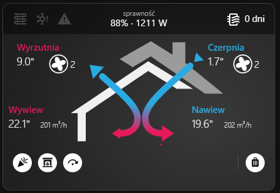

# Defro Air dla Home Assistant

Integracja rekuperatorów Defro Air (DRX) ze sterownikiem ST-340 v2 przez Modbus
(port BMS sterownika + bramka RS-485 → Modbus TCP). Konfiguracja z interfejsu.



## Wymagania

- Home Assistant 2026.10+
- bramka RS-485 w trybie **Modbus TCP** (np. USR-DR164, Elfin EW11A), port
  szeregowy jak w sterowniku (domyślnie 19200 8E1)
- komunikacja Modbus włączona w menu instalatora sterownika

## Instalacja

HACS → Własne repozytoria → dodaj to repozytorium jako „Integracja”, zainstaluj
„Defro Air”, zrestartuj HA. Potem: Ustawienia → Urządzenia i usługi → Dodaj
integrację → **Defro Air** i podaj adres bramki, port i adres sterownika (1).

## Karta

```yaml
type: custom:defro-air-card
device_id: ...   # opcjonalnie, gdy central jest kilka
title: ...       # opcjonalnie
```

Karta rejestruje się sama. Pokazuje temperatury, przepływy, biegi, sprawność
odzysku i dni filtrów oraz pozwala sterować: party (minuty), palenisko (3 min),
bypass, urlop (dni) i bieg 0–3 (jeśli sterownik obsługuje rejestr 157).

## Encje

| Typ | Co | Rejestry |
|---|---|---|
| sensor | przepływy, biegi, temperatury, sprawność, moc odzysku, filtry, błędy, zegar | 100–109, 138–139, 152–155 |
| binary_sensor | awaria, bypass, antyzamarzanie, urlop, GWC, grzanie wtórne, wejścia | 132–154 |
| switch | bypass, GWC | 140–141 |
| number | urlop (dni), palenisko (s), party (min) | 145–147 |
| button | synchronizacja zegara | 152–153 |
| fan, switch, number | bieg zadany i ustawienia — tylko nowsze programy | 156–174 |

Moduł **MBP 1.1.4** obsługuje tylko rejestry 100–155; integracja wykrywa to sama.

## Uwagi

- 105 to wywiew, a 107 wyrzutnia (w instrukcji odwrotnie).
- Brak czujnika temperatury: wartość 1715 lub 63066.
- Party 147 w minutach (min. 15), palenisko 146 w sekundach (maks. 180), zapis 0 wyłącza.
- Bramka obsługuje poprawnie tylko jednego klienta Modbus naraz.

## Testy

```
docker build -t defro-air-tests -f tests/Dockerfile .
docker run --rm -v "${PWD}:/src" defro-air-tests
```
